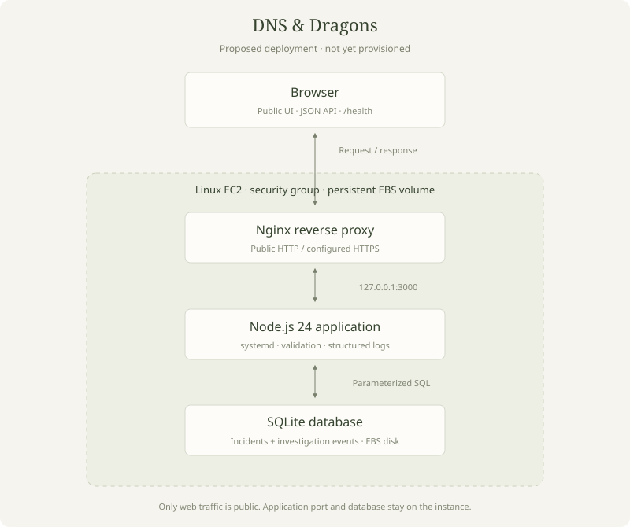
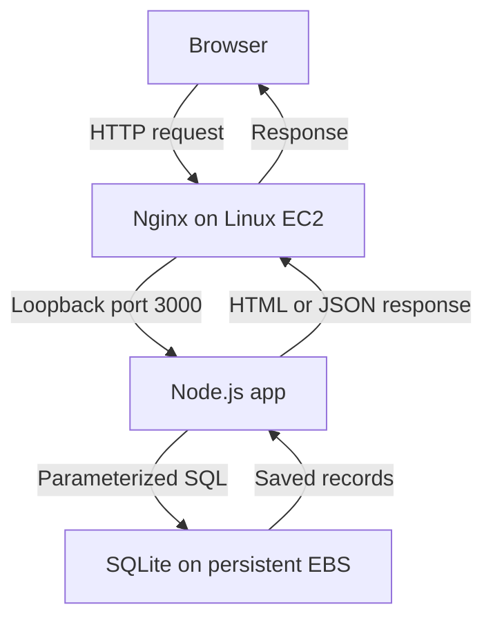

# DNS & Dragons

**Slay bugs. Save the realm.** A small incident tracker for fantasy infrastructure, built for the MangoApps DevOps take-home assignment.

Create an incident, choose a severity, assign an adventurer, and leave investigation notes as you move from **Investigating → Monitoring → Resolved**. Search by title, service, adventurer, description, or incident ID. Resolved encounters live in the Hall of Victories; they can be reopened with a new note.

## Run locally

Requires **Node.js 24.x**. There are no third-party npm dependencies, frontend build step, API keys, or external services.

```sh
node --version
npm start
```

Open **http://127.0.0.1:3000**. The database is created automatically at `data/realm.sqlite` and seeded once with six fictional incidents. Changes survive a process restart. `npm run dev` enables Node's file watcher; `npm test` runs the integration tests.

The UI uses plain HTML, CSS, and JavaScript. The server uses Node's HTTP module and its built-in `node:sqlite` API with parameterized SQL. SQLite's synchronous API is intentionally used for a tiny, single-process demo; it would need reconsideration for a busy service. Node 24's SQLite module is an evolving API, so use the documented 24.x runtime and verify tests when upgrading.

### Configuration

| Variable | Default | Purpose |
| --- | --- | --- |
| `HOST` | `127.0.0.1` | Bind address; use a reverse proxy for public access |
| `PORT` | `3000` | HTTP port |
| `DATABASE_PATH` | `data/realm.sqlite` | SQLite path; use a persistent directory on EC2 |
| `SEED_DEMO` | `true` | Set to `false` on the first launch for an empty ledger |

The default database path is relative to the project directory. A supplied relative `DATABASE_PATH` is relative to the process working directory. Node's `--port` and `--host` app arguments are also accepted. No `.env` loader is used: export variables in your shell or set them in systemd.

`preview.html` is a self-contained **design preview**. Open it directly in a browser to try the same UI without running Node. Its records live in memory only, reset on refresh, and its health panel is explicitly simulated. The actual app always uses server-side SQLite and a real health query. Regenerate the preview with `node scripts/build-preview.mjs`.

## Architecture — proposed EC2 deployment

**Status:** implemented and tested locally; not yet pushed to GitHub or deployed to AWS. This diagram describes the intended deployment, not an existing live environment.





The public page, API, and database-backed health endpoint come from the same app. A create/update request is validated, written in a transaction, and read back from SQLite. Investigation events and status changes are committed together. Static assets are served from an explicit allowlist; the database and source files are never exposed as assets.

### Why these choices

- **One Linux EC2 instance:** matches the assignment and keeps operations understandable. Record the selected instance type and Linux distribution after provisioning. Lambda would add a different hosting model and would not satisfy the EC2 requirement.
- **SQLite on the instance's EBS volume:** an actual relational database without another service, network rule, or database bill. RDS offers managed backups and stronger separation but adds infrastructure. This demo accepts a single point of failure and a small write workload.
- **Plain browser UI and Node:** no bundler or third-party runtime packages to manage. A larger framework would be useful if routing or product complexity grew.
- **Nginx + systemd:** proposed process supervision, startup after reboot, and a reverse proxy. Containers and CI/CD can be added later; they are not required for this version.

Example Nginx and systemd templates are in `deploy/`. They have **not been applied**. Before deploying, verify paths and the Node 24 executable, create the unprivileged service account, configure the persistent database directory, and check the current AWS account's Free Tier eligibility and resource prices. This project does not provision AWS resources or guarantee zero cost. Set a budget alert and avoid unneeded paid services.

The intended security group exposes the web port and restricts SSH to the administrator's IP (or use SSM); port 3000 and the database are not public. HTTPS should be configured for a public deployment when a hostname is available. Keep it running until the reviewer confirms they are done, then clean up resources that could incur charges.

## Health and logs

```sh
curl -i http://127.0.0.1:3000/health
```

Healthy response: HTTP 200 and `{"status":"ok","realm":"operational","app":"ok","database":"ok",...}`. The handler executes a real query against the incidents table. It returns **HTTP 503** if the database query fails. Process uptime is not a historical availability measurement. The UI checks this endpoint on load and every minute.

Each request writes a structured JSON log to stdout with method, path, status, and duration. Under systemd these are available through `journalctl -u dns-dragons`. Request bodies and investigation notes are not logged.

## API

| Method | Path | Behavior |
| --- | --- | --- |
| GET | `/api/incidents` | List incidents, newest first |
| GET | `/api/incidents/:id` | Incident and investigation history |
| POST | `/api/incidents` | Create: `title`, `description`, `severity`, `service`, `assignee` |
| PATCH | `/api/incidents/:id` | Add a required `note` and set `status` |
| GET | `/health` | Query database; HTTP 200 or 503 |

All writes require `application/json`. Allowed severities are `SEV-1`, `SEV-2`, `SEV-3`; statuses are `investigating`, `monitoring`, `resolved`. The server enforces field lengths, a 16 KB request limit, 500 incidents, 200 updates per incident, and 30 writes per socket IP per minute. Behind a local reverse proxy, that in-process rate budget is shared by visitors; it intentionally does not trust forwarded IP headers. It resets on restart and is not a production abuse-control system.

## Security and limits

This is a **shared, unauthenticated demonstration**, similar to a guestbook. Anyone with the URL can create and update fictional incidents. Do not store credentials, personal data, or actual incident information. There is no delete endpoint or automatic cloud remediation.

User content is rendered as escaped text. The server uses SQL parameters, same-origin write checks, strict JSON content types, a Content Security Policy, bounded requests, and basic security headers. The app process should run as an unprivileged user. Runtime database files, `.env`, and logs are excluded from Git.

Before real use, add authentication and authorization, HTTPS, durable backups with restore drills, monitoring and alerts, an audit trail tied to identities, pagination, stronger rate limiting, and a tested recovery plan. SQLite is persistent across process restarts, but does not survive losing its volume. Back up a live database with SQLite's backup API/tooling, rather than copying only the main file while WAL writes are active.

## Verification

`npm test` exercises create/update/resolve/reopen, persistence after restart, field validation, cross-origin protection, SQL-like inputs, static file isolation, rate limiting, and database failure producing HTTP 503. Tests use temporary databases, not the demo's data.

Browser QA of the running server was unavailable in the authoring environment because its preview relay was unavailable. Test the UI in a real browser before final deployment, including a narrow mobile viewport, keyboard dialog controls, and the complete create → resolve → reopen flow.

## Suggested 2–5 minute demo

1. Open the **live EC2 URL**, create an incident, and refresh to show it persists.
2. Add an investigation note, mark Monitoring, and resolve it. Open the Hall of Victories.
3. Show `/health` and the architecture diagram; explain the chosen Linux distribution, instance, database, and traffic path, plus alternatives.
4. Explain access rules, secret handling, and actual Free Tier/budget checks.
5. Describe one **real deployment issue you encountered**, the evidence you used, and how you verified the fix. Do not present a seeded fantasy incident as a real troubleshooting story.
6. Mention authentication, backups, and monitoring as next steps.

The final submission still needs the live URL, repository URL, actual architecture choices, video, and your own eligibility confirmation. AI tools were used to assist implementation; be ready to explain each piece.
